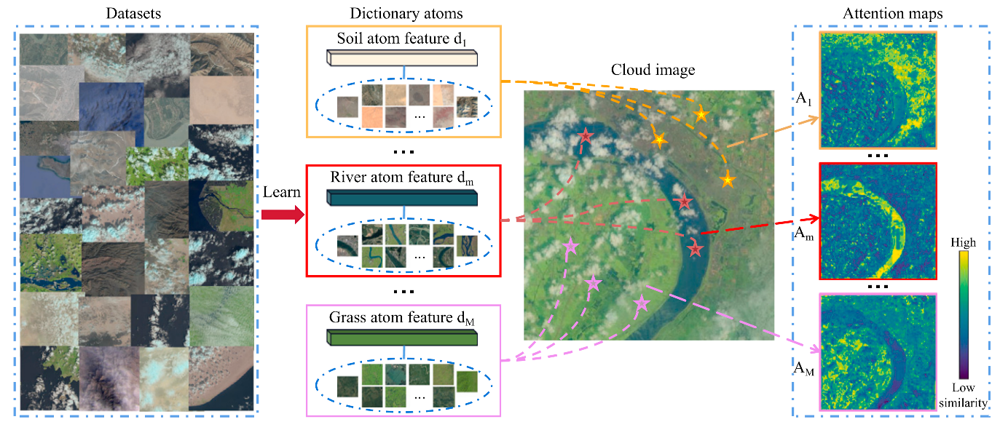
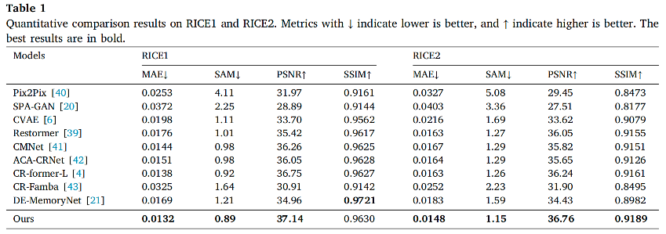
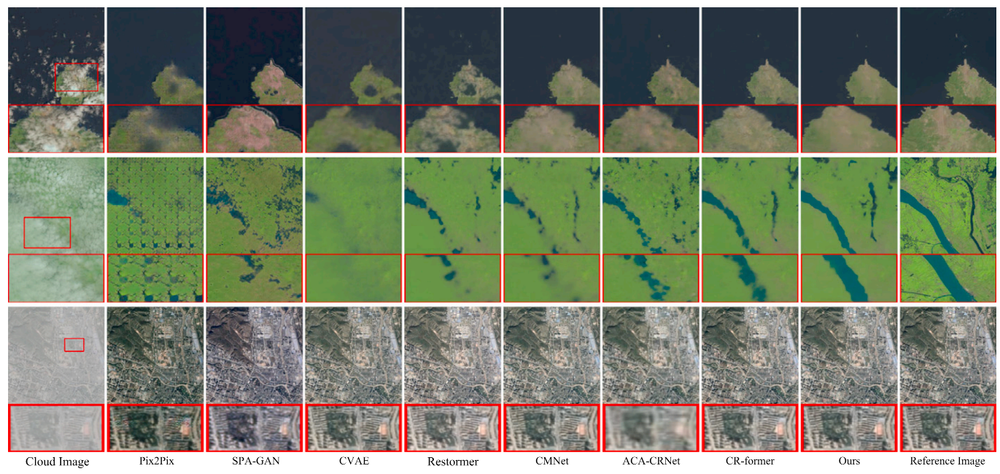

# DictCR-former: Content-aware Dictionary Transformer for Cloud Removal

Wenli Huang, Yang Wu, Sanping Zhou, Xiaomeng Xin, Xiaobo Jia, Ping Yu, Ye Deng, 2026


## Abstract

Cloud cover can obscure important surface information in remote sensing imagery, making single-image cloud removal challenging. Existing methods often rely on contextual relationships within the cloudy image itself; when clouds hide important regions, the available context may be insufficient for reliable reconstruction.

We propose **DictCR-former**, a dictionary-based Transformer for remote sensing image cloud removal. Its core component, **Content-Aware Dictionary Attention (CADict-Att)**, aggregates cross-image contextual information through two components: **Content-Aware Dictionary Learning (CADL)** dynamically constructs dictionary atoms from training features to encode recurring semantic patterns, while **Dictionary Aggregation (DA)** adaptively combines relevant atoms using learnable attention weights. The resulting contextual features help reconstruct cloud-obscured regions while maintaining spatial consistency with visible areas. Experiments on RICE-I, RICE-II, T-CLOUD, and SEN12MS-CR demonstrate improved cloud-removal performance while maintaining computational efficiency.



## Installation

**Environment**

Use the versions specified by the released environment file or project configuration. If the repository provides `environment.yml`, `requirements.txt`, or a Dockerfile, follow that file as the source of truth.

Clone the repository (replace `<YOUR-REPOSITORY-URL>` with the actual repository URL):

```bash
git clone <YOUR-REPOSITORY-URL>
cd DictCR-former
```

If an environment file is provided, create and activate the environment. For example:

```bash
conda env create -f dictcr-env.yml
conda activate dictcrformer
```

If the repository uses a different environment filename or environment name, update the commands accordingly. The exact Python, PyTorch, CUDA, and GPU requirements should be taken from the released implementation and tested configuration.

## Contents

1. [Method Overview](#method-overview)
2. [Datasets](#datasets)
3. [Models](#models)
4. [Training](#training)
5. [Testing](#testing)
6. [Results](#results)
7. [Citation](#citation)
8. [License](#license)
9. [Acknowledgements](#acknowledgements)

## Method Overview

DictCR-former addresses information loss caused by cloud occlusion by supplementing the target image's features with reusable contextual patterns learned across training images.

### Content-Aware Dictionary Attention (CADict-Att)

CADict-Att consists of two main components:

- **Content-Aware Dictionary Learning (CADL):** uses learnable cross-attention to dynamically construct dictionary atoms from training features. The atoms encode recurring semantic patterns and cross-image correlations.
- **Dictionary Aggregation (DA):** measures the relevance between cloudy-image features and dictionary atoms, then aggregates contextually relevant atoms with learnable attention weights.

The retrieved dictionary features provide additional context for reconstructing cloud-obscured areas. The goal is to improve restoration fidelity while preserving spatial consistency between reconstructed and unobscured regions.

## Datasets

The paper evaluates DictCR-former on four cloud-removal benchmarks:

- **RICE-I:** 500 pairs of thin-cloud and cloud-free images obtained from Google Earth. [Dataset repository](https://github.com/BUPTLdy/RICE_DATASET)
- **RICE-II:** 736 pairs of Landsat 8 OLI/TIRS images, including cloudy, cloud-free, and cloud-mask images. The masks identify cloud-affected regions, cloud shadows, and cirrus clouds. [Dataset repository](https://github.com/BUPTLdy/RICE_DATASET)
- **T-CLOUD:** 2,939 paired Landsat 8 RGB images for thin-cloud removal, cropped into 256 × 256 patches. The dataset includes 2,351 training pairs and 588 testing pairs. [Dataset repository](https://github.com/haidong-Ding/Cloud-Removal)
- **SEN12MS-CR:** approximately 110,000 samples from 169 geographically distinct regions. Each sample includes cloudy and cloud-free Sentinel-2 imagery and a corresponding Sentinel-1 SAR image. [Dataset page](https://mediatum.ub.tum.de/1554803)

Download and organize the datasets according to the directory structure expected by the configuration files. Check the dataset loader and configuration files in the released code for the exact folder names, image naming rules, and train/test splits.

## Models

Pretrained weights should be linked here when released.

| RICE-I  | [Baidu Netdisk (code: yg1a)](https://pan.baidu.com/s/1oK_UyIMFdLFq7MzsaRBa_A?pwd=yg1a) |  
| RICE-II | [Baidu Netdisk (code: ngke)](https://pan.baidu.com/s/1rLhQ41Qli23L_D0H8nI2vA?pwd=ngke) |  
| T-CLOUD | [Baidu Netdisk (code: ebmg)](https://pan.baidu.com/s/10VyNIwJDyGNSoqE0UlDAvA?pwd=ebmg) |

| Dataset | Pretrained weights                                                                       |
| ------- | ---------------------------------------------------------------------------------------- |
| RICE-I  | [Baidu Netdisk (code: 3w2a)](https://pan.baidu.com/s/1vwNhZdNZrkD41uQChN_AhQ?pwd=3w2a)   |
| RICE-II | Baidu Netdisk (code: cdv7)\](<https://pan.baidu.com/s/1tCPyffzya4fZ7oZ2NqR70Q?pwd=cdv7>) |
| T-CLOUD | Baidu Netdisk (code: 3jhp)\](<https://pan.baidu.com/s/1rRR7hNfDWsWEmBUJ1ebh_Q?pwd=3jhp>) |

After downloading a checkpoint, place it in the directory expected by the corresponding test configuration, or set the checkpoint path explicitly in that configuration.

## Training

Use the training configuration files supplied with the repository. The exact configuration names and entry-point scripts depend on the released code; the commands below are templates and should be replaced with the actual filenames.

Typical configuration fields include:

- `dataroot_gt`: path to the clear/cloud-free ground-truth images, if used by the dataset loader.
- Input or cloudy-image directory: path to the cloud-contaminated images.
- `name`: experiment name.
- Checkpoint and logging paths: locations for saving model weights, logs, and intermediate results.

Example command pattern:

```bash
# Replace these paths with the actual training entry point and configuration.
python train.py --config <PATH-TO-TRAIN-CONFIG>
```

Run the provided training scripts (original setup: 256 × 256 inputs and one A100 GPU):

```bash
# RICE-I
sh train_script/rice1.sh

# RICE-II
sh train_script/rice2.sh

# T-CLOUD
sh train_script/t_cloud.sh
```

The dictionary-learning and dictionary-aggregation components are part of the proposed CADict-Att mechanism. Use the released implementation and paper configuration to reproduce the reported setup; do not assume that configuration names from another cloud-removal model are interchangeable.

## Testing

Download the appropriate pretrained checkpoint, prepare the test split, and run the repository's test entry point with the corresponding configuration.

Example command pattern:

```bash
# Replace these paths with the actual testing entry point and configuration.
python test.py --config <PATH-TO-TEST-CONFIG> --weights <PATH-TO-CHECKPOINT>
```

Use the RICE-I, RICE-II, or T-CLOUD test dataset, and run:

```bash
# RICE-I
sh test_script/rice1_test.sh

# RICE-II
sh test_script/rice2_test.sh

# T-CLOUD
sh test_script/t_cloud_test.sh
```

Check the released test script for the exact argument names. Depending on the implementation, these may include:

- configuration file path;
- cloudy input image directory;
- ground-truth image directory, when metrics are calculated;
- output directory for restored images;
- pretrained checkpoint path.

Record the dataset split and evaluation settings when comparing results. For a fair comparison, use the same test images and evaluation protocol as the paper.

## Results

The paper reports evaluations on RICE-I, RICE-II, T-CLOUD, and SEN12MS-CR. It finds that DictCR-former improves cloud-removal performance over the compared methods while maintaining computational efficiency. Please refer to the paper for the exact quantitative values and evaluation settings.

<details>

<summary><strong>Quantitative comparison (click to expand)</strong></summary>
Quantitative comparison results on RICE1 and RICE2. Metrics with ↓ indicate lower is better, and ↑ indicate higher is better. The best results are in bold.

<p align="center">  
    
</p>

Add the quantitative comparison table here after placing the corresponding image or Markdown table in the repository.

</details>

<details>

<summary><strong>Visual comparison (click to expand)</strong></summary>

Visualization of cloud removal results for the RICE1 and RICE2 datasets. Local details (red boxes) are enlarged at the bottom for clarity. (For interpretation
of the references to color in this figure legend, the reader is referred to the web version of this article.).

<p align="center">  
    
</p>

</details>

## Citation

If you find this work useful, please cite the paper:

```bibtex
@article{huang2026dictcrformer,
  title   = {DictCR-former: Content-aware dictionary transformer for cloud removal},
  author  = {Huang, Wenli and Wu, Yang and Zhou, Sanping and Xin, Xiaomeng and Jia, Xiaobo and Yu, Ping and Deng, Ye},
  journal = {Pattern Recognition},
  volume  = {180},
  pages   = {114154},
  year    = {2026},
  doi     = {10.1016/j.patcog.2026.114154}
}
```

## License

Add the repository's actual license here. If a `LICENSE` file is included, refer to that file for the authoritative terms. Do not assume that the code or pretrained models use the same license as another project.

## Acknowledgements

Add acknowledgements for the codebases, datasets, and tools used by the released implementation. Ensure that all third-party projects are credited according to their original licenses and citation requirements.
